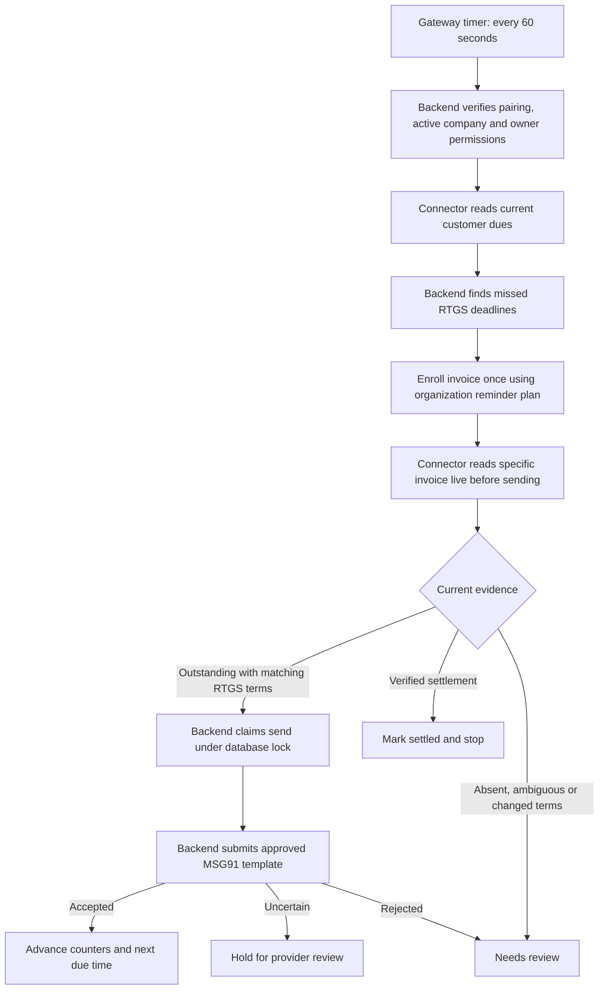

# RTGS cash discount and automatic payment follow-ups

Client rules confirmed on 12 October 2026:

| Narration pattern | CD | Last qualifying payment date | Follow-ups start |
| --- | --- | --- | --- |
| ADVANCE RTGS | 1.5% | Day before invoice date | Beginning of invoice date, IST |
| SAME DAY RTGS | 1% | Invoice date | Beginning of next day, IST |

Detection accepts case, spacing, hyphens and RTGS punctuation variants, with vehicle text around the pattern. Conflicting patterns require review. Percentages alone do not establish a category. Regular credit terms do not enroll in automatic RTGS reminders; existing manual collection workflows remain available.

Full payment must meet the category deadline. Partial payment does not preserve the discount; the full category discount is recoverable. Advance payment made on the invoice date does not downgrade to 1%. The existing calculation basis remains: Tally invoice value is treated as net after its category CD, gross = net / (1 - rate), and full recovery = gross - net. Confirmed recovery debit notes are subtracted to prevent duplicate recovery. Debit-note creation remains an operator action with a fresh Tally recheck. Receipts proving complete, on-time payment produce zero recovery.

Recovery vouchers quote the invoice narration but cannot qualify recursively for CD or enroll another automatic sequence. Standard non-sales vouchers are excluded.

## Runtime flow



The dashboard can be closed. The API/gateway process and paired connector must remain running with the mapped Tally company open. Initial detection can take a scan; each send has its own targeted live check, bypassing saved open-bill results. Background discovery waits if local dues are still being verified. Only invoices within the configured customer scope and reviewed current financial-year mapping participate. Carry-forward bills retain their original dates.

Automatic enrollment requires a valid Indian customer WhatsApp number, active organization access, and the paired connection owner's current follow-up prepare/export permissions. Missing numbers do not send; add the number or use the existing manual flow. At most 25 new schedules and 25 due invoices are processed per cycle; later invoices continue in later cycles. The first due time is the missed deadline plus the first stage's configured delay. Repeated submissions follow the organization stage intervals and limits; missed cycles do not generate accumulated catch-up messages.

Partial payments update the reminder amount. Missing bills are settled only with verified signed invoice allocation evidence; disappearance alone requires review. Paused/stopped/finished schedules are never automatically restarted. Existing manual schedules are not converted to automatic sending. Uncertain provider outcomes are never blindly retried. Provider acceptance means submitted, not confirmed delivered.

Settings → Payment reminders contains the automatic RTGS switch and the reminder sequence. Automatic RTGS is enabled by default for this release. Turning it off also stops submission from existing automatic schedules. Reminder tracking identifies automatic schedules and refreshes every 30 seconds while idle.

Cash discount scans still evaluate open invoice balances. Fully closed historical invoices with late payments need a separate recovery review; this change does not perform a company-wide historical audit.

## Rollout

1. Apply `supabase/migrations/20261012081410_rtgs_payment_followup_automation.sql` to Kalika after the existing reminder and stable-installation migrations. Existing rows remain manual. New columns retain the table's RLS and service-role-only grants.
2. Deploy frontend and API/gateway together. Use the approved MSG91 configuration already used by payment reminders.
3. Package and install connector **1.2.29**. Older connectors return raw scan evidence for the backend's new RTGS calculation and do not start background automation. `node scripts/build-tally-connector-installer.mjs` packages the installer; `--validate` checks sources only.
4. Verify the organization's automatic switch, customer scope, WhatsApp numbers and reminder plan before enabling the updated production stack. Test with an agreed recipient before broad rollout.

No hosted migration, deployment, Tally posting or live WhatsApp submission was performed while implementing this change. Automated checks use isolated transports and a disposable PostgreSQL database.

## Verification commands

```powershell
node scripts/build-connector-collections-analysis.mjs --check
npm run typecheck
node --test --experimental-strip-types apps/api/src/lib/cash-discount-narration.test.mjs apps/api/src/lib/payment-follow-up.test.mjs apps/api/src/lib/followups/automatic-route.test.mjs apps/cash-discount-gateway/src/followup-automation.test.mjs
node --test apps/cash-discount-gateway/src/server.test.mjs
node scripts/build-tally-connector-installer.mjs --validate
```

`scripts/test-rtgs-followup-automation.sql` is a disposable PostgreSQL fixture, not a migration. It verifies duplicate/finished enrollment protection, stale/paused/uncertain send rejection, existing claim behavior and RLS/client grants. Never run this fixture on a hosted project.
